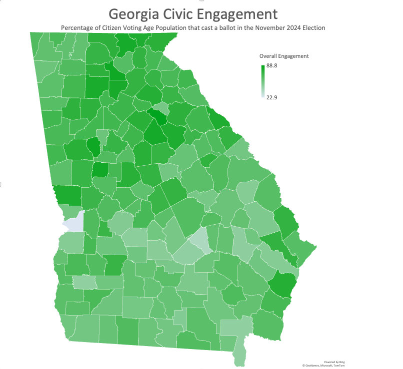

# GA_Civic_Engagement
Code files to implement public portfolio project that level-sets Georgia November 2024 election turnout against the U.S. Census Bureau's estimate of the citizen voting age population.

## Business Problem
I am a poll manager for the Glynn County Board of Elections and Registration in Georgia, and the experience has increased my interest in factors that impact voter turnout.  The U.S. Census Bureau and the Georgia Secretary of State publish official datasets on population and voting, respectively.  I selected these for analysis because they allow me to answer these business questions applicable to civic groups interested in increasing participation in elections:
 - How much variability is there among Georgia counties in voter participation?
 - Where are the opportunities to increase engagement through voter registration?  Turnout of registered voters?

				
## Key Findings
 - **High Variance**  There's a remarkably wide range of engagement among Georgia's 159 counties. 
 - **Peak Engagement** Over 80% of Oconee County's citizen voting age population voted in the election.  
 - **Opportunites** Under 40% of the citizen voting age population of Chattahoochee and Wheeler Counties cast a ballot.

## Data Sources
- US Census Bureau Citizen Voting Age Population (https://www.census.gov/programs-surveys/decennial-census/about/voting-rights/cvap.html)
- Georgia November 2024 Registered Voters (https://sos.ga.gov/election-data-hub)
- Georgia November 2024 Election Results (https://results.sos.ga.gov/results/public/Georgia/elections/2024NovGen/reports)

## Tech Stack
- Anaconda (https://www.anaconda.com/download)

## Features
- Import files, format data, merge, and export results ([GA Civic Engagement Data Prep Script])(https://github.com/brouilc/GA_Civic_Engagement/blob/main/GA_Civic_Engagement_Data_Prep)

## Contact
Beau Brouillette - [LinkedIn](https://www.linkedin.com/in/beau-brouillette) - brouillette.beau@gmail.com
